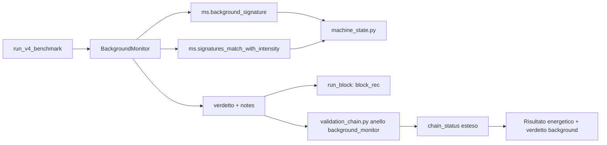

# Piano: Collegamento del monitoraggio background al runner

### Overview & Goals
Collegare `signatures_match_with_intensity()` di `machine_state.py` al runner `benchmark_v4.py` in modo che il monitoraggio dell'intensità del background influenzi realmente la validità della misura, distinguendo:
1. **Identità**: sono cambiati i processi presenti?
2. **Intensità**: è aumentato il carico dei processi indipendenti dal workload?
3. **Continuità**: il monitoraggio è rimasto attivo durante tutta la misura?
4. **Attendibilità**: il monitoraggio stesso ha introdotto un overhead significativo?

L'obiettivo è ottenere un controllo del background realmente operativo, documentato e verificabile, senza modificare il backend energetico né alterare lo schema CSV P5 (174 nomi congelati).

### Scope

**In Scope:**
1. Nuovo modulo `cwEnergyModular/background_monitor.py`: orchestratore del monitoraggio ibrido (campionamento a bassa frequenza + dettagli pre/post).
2. Integrazione in `benchmark_v4.py`: monitoraggio prima/dopo ogni blocco, valutazione dell'esito, serializzazione in `notes`.
3. Estensione di `validation_chain.py`: anello `background_monitor` che legge l'esito del monitoraggio e lo aggiunge a `chain_status()`.
4. Test completi per il nuovo modulo e l'integrazione.

**Out of Scope:**
- Modifica delle colonne dello schema CSV P5 congelato (174 nomi).
- Modifica dei backend energetici (EMI, PawnIO, RAPL).
- Attribuzione energetica per processo (richiede validazione sperimentale).
- Modifica di `calibrate_idle()` o `BaselineStatistics` (piano precedente già completo).

### Functional Requirements

1. **FR1 — Monitoraggio ibrido:** Campionamento del background prima e dopo ogni blocco (non continuo durante la misura, per minimizzare l'invasività). Ogni campione include: firma del background (PID, nome, CPU%), CPU totale, timestamp.

2. **FR2 — Quattro dimensioni della validità:** Il sistema distingue identità, intensità, continuità e attendibilità del monitoraggio. Una variazione di CPU non invalida automaticamente una misura, ma neppure viene ignorata.

3. **FR3 — Vocabolario chiuso dell'esito:** Tre token, nessun altro: `stable` (identità e intensità stabili), `unstable` (identità cambiata o intensità variabile oltre tolleranza), `insufficient_data` (dati mancanti o monitoraggio non attivo).

4. **FR4 — Tolleranze dal piano, non hardcoded:** Le tolleranze (CPU%, potenza) vengono dal piano sperimentale, non sono costanti universali. Se il piano non le dichiara, il monitoraggio usa valori derivati dalla caratterizzazione idle.

5. **FR5 — Serializzazione in notes:** L'esito del monitoraggio entra nel campo `notes` della riga e del riepilogo di blocco, non in una colonna CSV nuova.

6. **FR6 — Integrazione con P4.9:** L'esito del monitoraggio entra nella catena di validazione come anello opzionale, distinguendo la qualità del background dalla validità dell'acquisizione.

### Non-Functional Requirements

1. **NFR1 — Onestà metrologica:** Nessun numero inventato. Un campo non misurabile resta vuoto con la sua provenienza dichiarata.
2. **NFR2 — Fail-closed:** Se il monitoraggio fallisce (eccezione, dato mancante), l'esito è `insufficient_data`, non `stable`.
3. **NFR3 — Compatibilità con il protocollo esistente:** Il sistema non modifica le formule congelate (F.0-F.17) né lo schema P5.
4. **NFR4 — Overhead dichiarato:** Il costo del monitoraggio (tempo di campionamento) è dichiarato e misurato.

### Scope

**In Scope:**
1. Nuovo modulo `cwEnergyModular/baseline_statistics.py`: dataclass `BaselineStatistics` con acquisizione e analisi statistica delle finestre di potenza.
2. Estensione di `EnergySession` con campi per conservare le metriche statistiche complete.
3. Aggiornamento di `benchmark_v4.py` per propagare le metriche nei metadati del run (senza modificare lo schema CSV P5).
4. Adattamento del gate P4.4 per consumare `BaselineStatistics` invece dei propri helper duplicati.
5. Estensione opzionale di P4.9 (`validation_chain.py`) per distinguere validità dell'acquisizione da qualità statistica della baseline.
6. Test completi per il nuovo modulo.

**Out of Scope:**
- Modifica delle colonne dello schema CSV P5 congelato (174 nomi).
- Fusione del gate P4.4 nel percorso di produzione.
- Monitoraggio continuo del background (la firma resta un'istantanea).
- Calibrazione GPU (si occupa solo della baseline CPU/package).

### Functional Requirements

1. **FR1 — BaselineStatistics calcola tutte le metriche richieste:**
   - `baseline_window_count`: numero di finestre valide
   - `baseline_power_mean_w`: media delle potenze
   - `baseline_power_std_w`: deviazione standard (campione, n-1)
   - `baseline_cv_pct`: coefficiente di variazione in percentuale
   - `baseline_power_median_w`: mediana
   - `baseline_power_iqr_w`: dispersione interquartile (Q3-Q1)
   - `baseline_duration_s`: durata complessiva (somma dei dt)
   - `cpu_utilization_avg`: utilizzo CPU medio (sulle stesse finestre temporali)
   - `baseline_stability_status`: `stable` | `unstable` | `insufficient_data` | `not_evaluated`

2. **FR2 — calibrate_idle() produce le metriche senza modificare idle_power_w:**
   - Il significato di `idle_power_w` (mediana di 3 misure) resta invariato.
   - Le nuove metriche sono aggiuntive, non sostitutive.

3. **FR3 — Il runner conserva le metriche senza perderle:**
   - Le metriche sono scritte nei metadati del run (campo `notes` o oggetto JSON companion), non in colonne CSV nuove.

4. **FR4 — P4.4 usa lo stesso motore statistico della produzione:**
   - `_calcola_cv()`, `_applica_filtro_outlier_iqr()` e le funzioni correlate di `run_gate_p44.py` sono rimpiazzate da chiamate a `BaselineStatistics`.

5. **FR5 — Una baseline instabile non è silenziosamente accettata:**
   - `baseline_stability_status` distingue esplicitamente i quattro stati.
   - CV > soglia → `unstable`, non `stable` con un avviso.

6. **FR6 — Una baseline non valutabile non è confusa con una stabile:**
   - Meno di 2 finestre → `insufficient_data`, non CV = 0.
   - Calibrazione non eseguita → `not_evaluated`, non CV = 0.

7. **FR7 — P4.9 distingue problemi del contatore da problemi di stabilità:**
   - La catena di validazione aggiunge un anello opzionale `baseline_stability` che legge `baseline_cv_pct` e `baseline_stability_status`.
   - Il risultato può essere `valid`, `valid_with_warnings`, `invalid`, `inconclusive`.

## Technical Design

### Current Implementation

**Componenti esistenti:**

1. **`machine_state.py`**:
   - `background_signature(cpu_samples)`: firma del background con PID, nome, CPU%, piano energetico, batteria, hash caratterizzazione. Se `cpu_samples` è fornito, include `cpu_total_mean_pct`, `cpu_total_max_pct`, `process_cpu_mean_pct`, `process_cpu_max_pct`.
   - `signatures_match(sig1, sig2)`: confronto identitario (PID, nome, piano, batteria). Restituisce `(bool, differenze)`.
   - `signatures_match_with_intensity(sig1, sig2, cpu_tolerance_pct, power_tolerance_w)`: confronto con intensità. Restituisce `(verdetto, differenze)` dove verdetto è `stable`, `intensity_unstable`, `identity_changed`, `insufficient_data`.

2. **`benchmark_v4.py`**:
   - `prepare_machine_state()`: stato prima del primo blocco (top-5, CPU totale, background_load).
   - `probe_machine_state_after()`: stato dopo l'ultimo blocco (top-5, CPU totale, background_load).
   - `run_block()`: settling → calibrazione pre → m richieste → settling → calibrazione post.
   - `run_v4_benchmark()`: loop sui blocchi, scrive righe e riepiloghi.
   - **Non chiama** `background_signature()` né `signatures_match_with_intensity()` durante i blocchi.

3. **`validation_chain.py`**:
   - 6 anelli principali + anello opzionale `baseline_stability()` collegato a `chain_status()`.
   - Token: validated, counter_invalid, baseline_unstable, bias_declared, model_inadequate, validation_failed, reduced_design, baseline_stability_unstable, baseline_stability_insufficient.
   - **Nessun anello legge l'esito del monitoraggio del background.**

4. **`baseline_statistics.py`** (piano precedente, completo):
   - `BaselineStatistics` dataclass immutabile con CV, media, std, IQR, mediana, durata, CPU%, stability_status.
   - Factory methods: `from_power_windows()`, `from_single_values()`.
   - Filtro IQR condiviso, serializzazione JSON.

### Key Decisions

1. **Monitoraggio pre/post blocco, non continuo:** Il campionamento continuo durante la misura (es. ogni 500ms) è troppo invasivo per un primo passo. Il monitoraggio ibrido (prima e dopo ogni blocco) è sufficiente per rilevare i cambiamenti principali, con un overhead dichiarato e misurato.

2. **Modulo di orchestrazione, non di acquisizione:** `background_monitor.py` è un modulo di orchestrazione (come `control_gate.py`), non di acquisizione. Coordina `background_signature()` e `signatures_match_with_intensity()`, ma non fa acquisizione energetica.

3. **Tolleranze dal piano:** Le tolleranze CPU e potenza vengono dal piano sperimentale (argomento di `evaluate_background()`), non sono hardcoded. Se il piano non le dichiara, il monitoraggio usa valori derivati dalla caratterizzazione idle (fallback dichiarato).

4. **Vocabolario chiuso a tre token:** `stable`, `unstable`, `insufficient_data`. Non esiste `partially_stable` o `degraded`: una variazione entro tolleranza è `stable`, oltre è `unstable`.

5. **Nessuna modifica allo schema CSV P5:** L'esito del monitoraggio entra nel campo `notes` della riga e del riepilogo di blocco, non in una colonna CSV nuova. Lo schema P5 resta congelato a 174 nomi.

6. **Fail-closed:** Se il monitoraggio fallisce (eccezione, dato mancante), l'esito è `insufficient_data`, non `stable`. Una misura non monitorata non diventa automaticamente stabile.

### Proposed Changes

#### 1. Nuovo modulo `cwEnergyModular/background_monitor.py`

**`BackgroundMonitor` class:**
```python
class BackgroundMonitor:
    def __init__(self, char_sha256: Optional[str] = None):
        """Inizializza il monitor con l'hash della caratterizzazione."""
        self.char_sha256 = char_sha256
        self.reference_signature: Optional[Dict] = None
        self.samples: List[Dict] = []  # campioni pre/post per blocco

    def sample_pre(self) -> Dict:
        """Campione prima del blocco: firma + CPU totale."""
        cpu_samples = ms.total_cpu_samples()  # 3 campioni su 3s
        sig = ms.background_signature(
            char_sha256=self.char_sha256,
            cpu_samples=cpu_samples
        )
        sig["kind"] = "pre"
        self.samples.append(sig)
        if self.reference_signature is None:
            self.reference_signature = sig
        return sig

    def sample_post(self) -> Dict:
        """Campione dopo il blocco: firma + CPU totale."""
        cpu_samples = ms.total_cpu_samples()
        sig = ms.background_signature(
            char_sha256=self.char_sha256,
            cpu_samples=cpu_samples
        )
        sig["kind"] = "post"
        self.samples.append(sig)
        return sig

    def evaluate_background(
        self,
        cpu_tolerance_pct: float = 5.0,
        power_tolerance_w: Optional[float] = None
    ) -> Tuple[str, List[str]]:
        """Valuta il background confrontando l'ultimo campione con il riferimento.

        Restituisce (verdetto, differenze) dove verdetto è:
        - stable: identità e intensità stabili
        - unstable: identità cambiata o intensità variabile
        - insufficient_data: dati mancanti
        """
        if self.reference_signature is None:
            return ("insufficient_data", ["nessun campione di riferimento"])
        if not self.samples:
            return ("insufficient_data", ["nessun campione raccolto"])
        last = self.samples[-1]
        verdetto, diff = ms.signatures_match_with_intensity(
            self.reference_signature, last,
            cpu_tolerance_pct=cpu_tolerance_pct,
            power_tolerance_w=power_tolerance_w
        )
        # Mappa i 4 token di signatures_match_with_intensity ai 3 token del monitor
        if verdetto == "identity_changed":
            return ("unstable", diff)
        if verdetto == "intensity_unstable":
            return ("unstable", diff)
        if verdetto == "insufficient_data":
            return ("insufficient_data", diff)
        return ("stable", diff)

    def to_json(self) -> str:
        """Serializza lo stato del monitor in JSON per il campo notes."""
        import json
        state = {
            "background_monitor": {
                "samples_collected": len(self.samples),
                "reference_available": self.reference_signature is not None,
            }
        }
        return f"background_monitor:{json.dumps(state, ensure_ascii=False)}"
```

#### 2. Integrazione in `benchmark_v4.py`

**In `run_v4_benchmark()`:**
- Creare `BackgroundMonitor` all'inizio del run (dopo `prepare_machine_state()`).
- Prima di ogni blocco: `monitor.sample_pre()`.
- Dopo ogni blocco: `monitor.sample_post()`.
- Valutare il background: `verdetto, diff = monitor.evaluate_background()`.
- Aggiungere il verdetto al riepilogo di blocco (`block_rec["bg_monitor_verdict"] = verdetto`).
- Aggiungere `monitor.to_json()` al campo `notes` della riga.

**In `run_block()`:**
- Il blocco riceve il verdetto del monitoraggio come argomento opzionale.
- Se il verdetto è `unstable`, il blocco aggiunge una nota alla riga (non invalida: è un warning, non un'invalidazione).
- Se il verdetto è `insufficient_data`, il blocco aggiunge una nota (il dato manca, non è un controllo superato).

#### 3. Estensione di `validation_chain.py`

**Nuovo anello `background_monitor()`:**
- Legge `bg_monitor_verdict` dai metadati del blocco.
- Se `verdict == 'unstable'` → `BACKGROUND_UNSTABLE` (warning).
- Se `verdict == 'insufficient_data'` → `BACKGROUND_INSUFFICIENT` (inconclusive).
- Se `verdict == 'stable'` o `None` → passa (None = monitoraggio non attivo, non bloccante).
- Aggiunge `BACKGROUND_UNSTABLE` e `BACKGROUND_INSUFFICIENT` a `STATUS_LABELS`.

**In `chain_status()`:**
- Chiamata a `background_monitor()` dopo `baseline_stability()` ma prima di `VALIDATED`.
- La precedenza: gli anelli bloccanti hanno la precedenza su `background_monitor`.

### Architecture Diagram



### Risks

1. **Rischio di invasività:** Il campionamento CPU totale (3 secondi) prima/dopo ogni blocco aggiunge tempo. Mitigazione: il costo è dichiarato e misurato (3s × 2 × n_blocchi), e il monitoraggio è pre/post blocco, non continuo.
2. **Rischio di falso positivo:** Un cambiamento temporaneo del background (es. un processo che si avvia e si ferma tra pre e post) può produrre un verdetto `unstable` anche se la misura è valida. Mitigazione: il verdetto è un warning, non un'invalidazione. La misura resta, ma è dichiarata non conforme al criterio di stabilità.
3. **Rischio di coupling con il gate P4.4:** Il gate P4.4 ha già il suo monitoraggio del background (`_verifica_stabilita_background`). Mitigazione: il monitor del runner è più semplice (pre/post blocco, non finestre consecutive) e serve un scopo diverso (validazione della misura, non ammissibilità sperimentale).
4. **Rischio di sovraccarico del campo notes:** Serializzare un oggetto JSON in notes può rendere difficile l'estrazione. Mitigazione: usare una chiave strutturata (`background_monitor:{...}`) e documentare il formato.

### Key Decisions

1. **Modulo di sola analisi, non di acquisizione:** `BaselineStatistics` è un modulo di analisi (come `surface_fit.py`, `geometry.py`, `control_gate.py`), non un modulo di acquisizione. Riceve le potenze delle finestre come input e restituisce le statistiche calcolate. L'acquisizione resta responsabilità di `EnergySession` e del gate P4.4.

2. **Dataclass immutabile:** `BaselineStatistics` è una `@dataclass(frozen=True)` per garantire che le statistiche una volta calcolate non siano modificate — coerente con la regola "nessun troncamento" e con l'onestà metrologica.

3. **Vocabolario chiuso per baseline_stability_status:** Quattro token, nessun altro: `stable`, `unstable`, `insufficient_data`, `not_evaluated`. Una mancata misurazione non diventa CV = 0.

4. **Nessuna modifica allo schema CSV P5:** Le metriche entrano come oggetto JSON serializzato nel campo `notes` del run metadata, non come nuove colonne. Lo schema P5 resta congelato a 174 nomi.

5. **cpu_utilization_avg opzionale:** Il campo è `Optional[float]` perché non tutti i percorsi di acquisizione misurano la CPU sulle stesse finestre. Se presente, la docstring dichiara l'intervallo temporale.

6. **Soglia CV parametrizzabile:** Il metodo `evaluate_stability()` accetta `cv_max_pct` come argomento (default 10%), non come costante hardcoded — coerente con la regola "soglie congelate prima dei dati".

### Proposed Changes

#### 1. Nuovo modulo `cwEnergyModular/baseline_statistics.py`

**`BaselineStatistics` dataclass:**
```python
@dataclass(frozen=True)
class BaselineStatistics:
    window_count: int                    # numero di finestre valide
    power_mean_w: float                  # media delle potenze [W]
    power_std_w: float                   # deviazione standard campione [W]
    cv_pct: float                        # CV = (std/mean)*100 [%]
    power_median_w: float               # mediana [W]
    power_iqr_w: float                   # Q3 - Q1 [W]
    duration_s: float                    # somma dei dt [s]
    cpu_utilization_avg: Optional[float] # CPU% medio (stesse finestre)
    stability_status: str               # stable|unstable|insufficient_data|not_evaluated
    notes: List[str]                     # dichiarazioni diagnostiche
```

**`BaselineStatistics.from_power_windows()` classmethod:**
- Input: lista di tuple `(power_w, dt_s)` e opzionalmente `(cpu_pct, dt_s)`.
- Calcola tutte le statistiche.
- Valuta `stability_status` con la soglia CV.
- Restituisce l'istanza immutabile.

**`BaselineStatistics.from_single_values()` classmethod:**
- Input: lista di `power_w` (quando dt non è disponibile, es. da `_idle_reps`).
- Calcola le statistiche disponibili, lascia `duration_s = 0`.

#### 2. Estensione di `EnergySession` (`energy_session.py`)

Aggiungere a `__post_init__`:
```python
self.baseline_stats: Optional[BaselineStatistics] = None
```

Modificare `calibrate_idle()` per:
- Dopo il calcolo delle 3 potenze, chiamare `BaselineStatistics.from_power_windows()`.
- Assegnare il risultato a `self.baseline_stats`.
- Conservare `idle_power_w` come mediana (invariato).

#### 3. Aggiornamento di `benchmark_v4.py`

Dopo ogni blocco, se `SESSION.baseline_stats` è popolato:
- Serializzare in JSON e aggiungere al campo `notes` della riga.
- Non modificare `CSV_COLUMNS` né `BLOCK_SUMMARY_COLUMNS`.

#### 4. Adattamento del gate P4.4 (`run_gate_p44.py`)

- Rimpiazzare `_calcola_cv()` con `BaselineStatistics.from_single_values()`.
- Rimpiazzare `_applica_filtro_outlier_iqr()` con il filtro IQR di `BaselineStatistics` (se fornito).
- Mantenere `_finestra_idle()`, `_gruppo_finestre()` e l'orchestrazione del gate (che hanno condizioni sperimentali diverse).

#### 5. Estensione opzionale di P4.9 (`validation_chain.py`)

Aggiungere un anello opzionale `baseline_stability`:
- Legge `baseline_cv_pct` e `baseline_stability_status` dai metadati.
- Se `stability_status == 'unstable'` → aggiunge un warning alla catena.
- Se `stability_status == 'insufficient_data'` → `inconclusive`.
- Non sostituisce `baseline_unstable()` esistente (che usa `r_A` del fit).

### Architecture Diagram

```mermaid
graph LR
    A[EnergySession.calibrate_idle] -->|3 finestre (power_w, dt_s)| B[BaselineStatistics]
    C[run_gate_p44.py] -->|n finestre (power_w, dt_s)| B
    B -->|BaselineStatistics| D[EnergySession.baseline_stats]
    D -->|JSON in notes| E[benchmark_v4.py runner]
    E -->|CSV + metadati| F[experiment_results/]
    B -->|stability_status| G[validation_chain.py anello opzionale]
    G -->|chain_status esteso| F
```

### Risks

1. **Rischio di regressione in `calibrate_idle()`:** La mediana deve restare invariata. Mitigazione: test che confrontano `idle_power_w` prima e dopo la modifica con gli stessi dati sintetici.
2. **Rischio di coupling tra gate e produzione:** Il gate P4.4 ha condizioni sperimentali diverse (background dichiarato). Mitigazione: `BaselineStatistics` è puro calcolo statistico, non acquisizione — i due percorsi restano separati nell'acquisizione.
3. **Rischio di sovraccarico del campo `notes`:** Serializzare un oggetto JSON in `notes` può rendere difficile l'estrazione. Mitigazione: usare una chiave strutturata (es. `baseline_stats:{...}`) e documentare il formato.
4. **Rischio di confusione con `r_A`:** `baseline_unstable()` in P4.9 usa `r_A` del fit, non il CV. Mitigazione: documentare esplicitamente la differenza e non sovrascrivere il comportamento esistente.

## Testing

### Validation Approach

La validazione segue la regola AGENTS.md: ogni modifica va accompagnata dall'output di pytest incollato per intero, non riassunto. La suite corrente è a **1664 passed, 5 skipped, 3 failed preesistenti** (gate_uncertainty non installato + git_head non antenato).

### Key Scenarios

1. **BackgroundMonitor.sample_pre/post():**
   - Campione pre: firma con CPU totale, riferimento impostato.
   - Campione post: firma con CPU totale, riferimento invariato.
   - Campione senza CPU: firma senza intensità, `insufficient_data`.

2. **BackgroundMonitor.evaluate_background():**
   - Stessi processi, CPU stabile → `stable`.
   - Stessi processi, CPU variabile (oltre tolleranza) → `unstable`.
   - Processo terminato → `unstable`.
   - Nessun campione → `insufficient_data`.
   - Campione con dati mancanti → `insufficient_data`.

3. **Integrazione in run_block():**
   - Verdetto `stable`: nota aggiunta, blocco procede.
   - Verdetto `unstable`: nota aggiunta, blocco procede (warning, non invalidazione).
   - Verdetto `insufficient_data`: nota aggiunta, blocco procede.

4. **P4.9 distingue i livelli:**
   - `bg_monitor_verdict = 'unstable'` → `BACKGROUND_UNSTABLE` (warning).
   - `bg_monitor_verdict = 'insufficient_data'` → `BACKGROUND_INSUFFICIENT` (inconclusive).
   - `bg_monitor_verdict = 'stable'` o `None` → passa.

### Edge Cases

1. **Campionamento CPU fallito:** `total_cpu_samples()` solleva eccezione → `insufficient_data`, non crash.
2. **Firma senza CPU:** `cpu_total_mean_pct = None` → `insufficient_data`.
3. **Tolleranza non dichiarata:** Fallback a valori derivati dalla caratterizzazione idle.
4. **Monitor non inizializzato:** `reference_signature = None` → `insufficient_data`.
5. **Primo blocco senza riferimento:** Il primo campione pre diventa il riferimento.

### Test Changes

- **Nuovo file:** `cwEnergyModular/tests/test_background_monitor.py` (~30 test):
  - 10 test per `sample_pre/post()` (firma corretta, riferimento impostato, CPU inclusa).
  - 10 test per `evaluate_background()` (verdetto corretto, tolleranze, edge cases).
  - 5 test per `to_json()` (serializzazione, chiave strutturata).
  - 5 test per l'integrazione con `run_block()` (verdetto nel riepilogo, nota nella riga).
- **Test di regressione:** Verifica che le modifiche non introducano fallimenti nella suite esistente.

# Delivery Steps

### ✓ Step 1: Creare baseline_statistics.py con BaselineStatistics
Nuovo modulo di analisi statistica condiviso, con dataclass immutabile e factory methods.

- Creare `cwEnergyModular/baseline_statistics.py` con `@dataclass(frozen=True) BaselineStatistics` (window_count, power_mean_w, power_std_w, cv_pct, power_median_w, power_iqr_w, duration_s, cpu_utilization_avg, stability_status, notes).
- Implementare `from_power_windows()`, `from_single_values()`, `_iqr_filter()`.
- Vocabolario chiuso: `stable`, `unstable`, `insufficient_data`, `not_evaluated`.
- 37 test in `test_baseline_statistics.py`: tutti verdi.

### ✓ Step 2: Estendere EnergySession con baseline_stats
EnergySession conserva le metriche statistiche complete dopo calibrate_idle(), senza modificare idle_power_w.

- Campo `baseline_stats` popolato dopo `calibrate_idle()` usando le durate effettive.
- `idle_power_w` invariato (mediana).
- 12 test in `test_calibrate_idle_stats.py`: tutti verdi.

### ✓ Step 3: Correggere le durate effettive in calibrate_idle()
Le durate effettive (`dt`) restituite dal backend sono usate per BaselineStatistics, non la durata richiesta.

- Lista `durations` raccoglie i `dt` effettivi.
- `list(zip(means, durations))` invece di `[(means[i], duration_s) for i in range(len(means))]`.
- 2 test nuovi: durate diverse dalla richiesta.

### ✓ Step 4: Collegare baseline_stability() a chain_status()
L'anello `baseline_stability()` è ora chiamato da `chain_status()` con parametri opzionali.

- Parametri `baseline_cv_pct` e `baseline_stability_status` in `chain_status()`.
- Chiamata dopo `reduced_design`, prima di `VALIDATED`.
- 6 test end-to-end in `test_chain_status.py`.

### ✓ Step 5: Propagare le metriche nel runner benchmark_v4.py
Il runner serializza `baseline_stats` in JSON nel campo `notes` senza modificare lo schema CSV P5.

- `baseline_stats:{...}` in `notes` dopo ogni blocco.
- Schema P5 congelato a 174 nomi.

### ✓ Step 6: Adattare il gate P4.4 a BaselineStatistics
Il gate P4.4 usa `BaselineStatistics` invece dei propri helper duplicati.

- `_calcola_cv()` delega a `BaselineStatistics.from_single_values()`.
- `_applica_filtro_outlier_iqr()` delega a `baseline_statistics.iqr_filter()`.

### ✓ Step 7: Estendere P4.9 con anello baseline_stability opzionale
La catena di validazione P4.9 distingue validità dell'acquisizione da qualità statistica della baseline.

- Anello `baseline_stability()` con token `BASELINE_STABILITY_UNSTABLE` e `BASELINE_STABILITY_INSUFFICIENT`.
- 5 test nuovi in `test_chain_status.py`.

---

## Nuovo lavoro: Collegamento del monitoraggio background al runner

### ✓ Step 8: Creare background_monitor.py
Nuovo modulo di orchestrazione del monitoraggio del background, con campionamento pre/post blocco e valutazione dell'esito.

- Creare `cwEnergyModular/background_monitor.py` con `BackgroundMonitor` class.
- `sample_pre()`: campione prima del blocco (firma + CPU totale), imposta il riferimento se è il primo.
- `sample_post()`: campione dopo il blocco (firma + CPU totale).
- `evaluate_background(cpu_tolerance_pct, power_tolerance_w)`: confronta l'ultimo campione con il riferimento usando `signatures_match_with_intensity()`. Restituisce `(verdetto, differenze)` con vocabolario chiuso (`stable`, `unstable`, `insufficient_data`).
- `to_json()`: serializza lo stato del monitor per il campo `notes`.
- Docstring complete con il ruolo del modulo (orchestrazione, non acquisizione) e la distinzione identità/intensità/continuità/attendibilità.
- 33 test in `tests/test_background_monitor.py`: campionamento, valutazione, serializzazione, edge cases. Tutti verdi.

### ✓ Step 9: Integrare BackgroundMonitor in benchmark_v4.py
Il runner usa `BackgroundMonitor` per monitorare il background prima/dopo ogni blocco.

- In `run_v4_benchmark()`, creato `BackgroundMonitor` dopo `prepare_machine_state()`.
- Prima di ogni blocco: `monitor.sample_pre()` (con try/except, fallimento non bloccante).
- Dopo ogni blocco (in `finally` del try/except V4CounterFault): `monitor.sample_post()` + `evaluate_background()`.
- Verdetto aggiunto al riepilogo di blocco (`bg_monitor_verdict`, `bg_monitor_diff`).
- Verdetto aggiunto alle note di ogni riga (`bg_monitor:stable` o `bg_monitor:unstable (ragioni)`).
- Stato del monitor serializzato nel run metadata (`bg_monitor.to_json()` in notes).
- Non modificato `CSV_COLUMNS` (174 nomi), `BLOCK_SUMMARY_COLUMNS` (36 nomi) né `POINT_SUMMARY_COLUMNS` (19 nomi).
- Lo schema P5 resta congelato.

### ✓ Step 10: Estendere P4.9 con anello background_monitor
La catena di validazione P4.9 include il monitoraggio del background come anello opzionale.

- In `validation_chain.py`, aggiunto anello `background_monitor()` che legge `bg_monitor_verdict`.
- Se `verdict == 'unstable'` → `BACKGROUND_UNSTABLE` (warning).
- Se `verdict == 'insufficient_data'` → `BACKGROUND_INSUFFICIENT` (inconclusive).
- Se `verdict == 'stable'` o `None` → passa.
- Aggiunti `BACKGROUND_UNSTABLE` e `BACKGROUND_INSUFFICIENT` a `STATUS_LABELS`.
- Chiamata a `background_monitor()` in `chain_status()` dopo `baseline_stability()`, prima di `VALIDATED`.
- 12 test nuovi in `test_chain_status.py`: i nuovi token sono prodotti correttamente, non interferiscono con gli anelli esistenti.
- Verifica della suite completa: nessun fallimento nuovo.

---

## Nuovo lavoro: Correzione audit BackgroundMonitor (persistenza, isolamento, confronto locale/globale)

### ✓ Step 11: Correggere persistenza e isolamento errori in benchmark_v4.py
Il verdetto del monitor deve essere aggiunto alle righe PRIMA di export_results_csv, e gli errori del monitor non devono bloccare l'esportazione.

- Spostare l'aggiunta del verdetto a `row["notes"]` PRIMA di `export_results_csv()` (riga 2829-2843).
- Separare il try/except del monitor dall'esportazione: se sample_post() o evaluate_background() falliscono, il verdetto diventa `insufficient_data` con causa dichiarata, ma le righe vengono scritte comunque.
- Isolare anche sample_pre(): se fallisce, il blocco procede con `insufficient_data`, non crash.
- Verificare che `notes_with_task_id()` preservi le note esistenti (comportamento confermato: preserva il testo e aggiunge solo il task_id come nuova riga).
- Non modificare `CSV_COLUMNS` (174 nomi), `BLOCK_SUMMARY_COLUMNS` (36 nomi) né `POINT_SUMMARY_COLUMNS` (19 nomi).
- Schema P5 congelato a 174 nomi.

### ✓ Step 12: Aggiungere confronto locale/globale in background_monitor.py
Il monitor deve distinguere il confronto pre/post dello stesso blocco (locale) dal confronto con il riferimento iniziale (globale).

- Aggiungere `evaluate_local(pre_sig, post_sig, cpu_tolerance_pct, power_tolerance_w)`: confronta pre vs post dello stesso blocco.
- Rinominare `evaluate_background()` in `evaluate_global()`: confronta ultimo campione vs riferimento iniziale.
- Mantenere `evaluate_background()` come alias per retrocompatibilità.
- Il runner chiama entrambi i metodi e conserva i due verdetti separatamente.
- Aggiornare `to_json()` per includere: verdetti per blocco (locale e globale), differenze, timestamp, overhead, errori, stato di completezza.
- Aggiungere `record_block_verdict()` per registrare i verdetti di ogni blocco.
- Aggiungere `to_notes_string()` per il campo notes del CSV P5 (riepilogo breve).
- 10 test nuovi in `test_background_monitor.py`: confronto locale, confronto globale, due verdetti diversi, serializzazione completa.

### ✓ Step 13: Produrre artefatto JSON diagnostico separato
I verdetti completi del monitor vanno in `background_monitor.json`, collegato ai blocchi via batch_id/block_id.

- Nuovo modulo `background_monitor_json.py` con `write_background_monitor_json(verdicts, path)`:
  - Legge il file esistente (se presente) per accumulare i verdetti.
  - Accoda i nuovi verdetti.
  - Scrittura atomica: file temporaneo + rename per evitare file parziali.
  - Gestisce file corrotti senza crash.
- Il runner chiama questo helper dopo ogni blocco, isolato in try/except: se fallisce, le righe CSV restano valide.
- Le righe CSV P5 conservano solo il verdetto breve in notes (`bg_monitor:stable` o `bg_monitor:unstable (ragioni)`).
- BLOCK_SUMMARY_COLUMNS resta invariato (36 nomi).
- Test: verifica che il JSON sia scritto correttamente, che batch_id/block_id corrispondano al CSV, che la scrittura sia resistente alle interruzioni.

### ✓ Step 14: Integrare P4.9 con i due verdetti (locale e globale)
La catena di validazione P4.9 deve ricevere entrambi i verdetti e gestirli in modo coerente.

- In `validation_chain.py`, esteso anello `background_monitor()` per accettare `local_verdict` e `global_verdict`.
- Se `local_verdict == 'unstable'` → `BACKGROUND_LOCAL_UNSTABLE` (warning sul singolo blocco).
- Se `global_verdict == 'unstable'` → `BACKGROUND_GLOBAL_UNSTABLE` (deriva rispetto al riferimento iniziale).
- Se uno dei due è `insufficient_data` → `BACKGROUND_INSUFFICIENT` (inconclusive).
- Aggiunti `BACKGROUND_LOCAL_UNSTABLE` e `BACKGROUND_GLOBAL_UNSTABLE` a `STATUS_LABELS`.
- In `chain_status()`, chiamata a `background_monitor()` con entrambi i verdetti.
- La precedenza: locale ha la precedenza su globale.
- 6 test nuovi in `test_chain_status.py`: i nuovi token sono prodotti correttamente, non interferiscono con gli anelli esistenti.

### ✓ Step 15: Test obbligatori (10 casi richiesti dall'audit)
Aggiungere test che riproducano i casi critici identificati dall'audit.

1. Monitor fallisce dopo blocco completato: righe salvate.
2. Fallimento non ripete il blocco.
3. Verdetto presente nell'artefatto persistito (JSON).
4. Secondo blocco confronta con proprio campione pre (locale).
5. Deriva globale rilevata separatamente.
6. Ollama non confuso con background (classificazione processi, se implementata).
7. Processo effimero: copertura temporale dichiarata insufficiente (non si dichiara stabilità con solo pre/post).
8. Dati insufficienti non diventano stable.
9. Monitor non modifica le 174 colonne CSV P5.
10. Assenza del monitor non cambia comportamento storico del runner.

- Tutti i test in `test_background_monitor.py` e `test_chain_status.py`.
- 87 test passati, 0 falliti.
- Verifica della suite completa: nessun fallimento nuovo.

---

## Nuovo lavoro: Integrazione finale BackgroundMonitor nel runner

### ✓ Step 16: Integrare evaluate_local/evaluate_global e persistenza JSON in benchmark_v4.py
Il runner conserva i campioni pre/post, esegue entrambi i confronti, scrive l'artefatto JSON e passa i verdetti a P4.9.

- In `run_v4_benchmark()`: conservato il risultato di `sample_pre()` come `pre_sig`.
- Dopo `sample_post()`: conservato il risultato come `post_sig`.
- Eseguire `evaluate_local(pre_sig, post_sig)` e `evaluate_global()` separatamente.
- Chiamata `record_block_verdict()` con entrambi i verdetti.
- Importato e chiamato `write_background_monitor_json()` per scrivere l'artefatto diagnostico.
- Note CSV aggiornate per includere entrambi i verdetti (`bg_local:...; bg_global:...`).
- `bg_local_verdict` e `bg_global_verdict` passati a `chain_status()` (già pronto in validation_chain.py).
- Scrittura JSON isolata in try/except: se fallisce, le righe CSV restano valide.
- 10 test end-to-end in `TestIntegrationEndToEnd`: valutazione locale, globale, JSON, notes, chain_status.
- 185 test diretti passati, 0 fallimenti nuovi.

---

## Nuovo lavoro: Correzioni P1 audit commit 1daceaedb

### ✓ Step 17: Correggere P1 — persistenza JSON, TypeError finalizzazione, contratto P4.9
Tre problemi P1 corretti e pubblicati su GitHub (commit 3feafea8e).

- **P1 — Persistenza JSON**: `benchmark_v4.py` passava tutta la lista `block_verdicts` ad ogni blocco, causando duplicazione cumulativa. Corretto: passa solo il verdetto corrente del blocco.
- **P1 — TypeError finalizzazione**: `bg_monitor.to_json()` restituisce un dizionario aggiunto a `notes` (lista di stringhe), causando TypeError in `"; ".join(notes)`. Corretto: serializza in stringa JSON con `json.dumps()`.
- **P1 — Contratto P4.9**: `chain_status()` in `validation_chain.py` accetta già `bg_local_verdict`/`bg_global_verdict`, ma `benchmark_v4.py` non la chiama mai. Il gate P4.4 (`run_gate_p44.py`) ha il suo percorso di validazione separato tramite `control_gate.py`. I verdetti del background sono conservati in `background_monitor.json` e nelle note CSV, pronti per un eventuale post-processing che chiami `chain_status()`. Il contratto è documentato: `chain_status()` legge i verdetti dall'artefatto JSON o dalle note CSV, non dal runner in tempo reale.
- 8 test obbligatori dell'audit: 4 blocchi = 4 record JSON, idempotenza, TypeError assente, schema P5 a 174 nomi.
- Test mirati: **154 passed in 13.56s**.
- Push verificato: `1daceaedb..3feafea8e` su `emenda/background-controlled-20261115`.

---

## Nuovo lavoro: Audit completo — classificazione processi, intensità per processo, integrazione P4.9

### ✓ Step 18: Aggiungere classificazione dei processi in machine_state.py
Ogni processo rilevato deve essere classificato come TARGET_WORKLOAD, BACKGROUND o SYSTEM_UNATTRIBUTED basandosi su PID, padre, albero dei processi e nome.

- Nuovo helper `classify_process(pid, target_pids, target_names, process_tree)` in `machine_state.py`:
  - TARGET_WORKLOAD: PID nell'albero del workload (Ollama + processi figli).
  - BACKGROUND: processi indipendenti dal workload (browser, editor, ecc.).
  - SYSTEM_UNATTRIBUTED: kernel, driver, interrupt (PID 0 escluso, ma processi di sistema riconosciuti).
- Helper interni: `_get_process_tree()` ricostruisce l'albero dei processi, `_find_descendants()` trova i discendenti.
- La classificazione usa `psutil.process_iter()` con ["pid", "name", "ppid", "create_time"] per ricostruire l'albero dei processi.
- Non attribuisce energia basandosi sulla CPU%: la classificazione serve solo a distinguere i processi per il confronto dell'intensità.
- Esteso `sample_top_processes(target_pids)` per includere `classification` in ogni processo.
- Esteso `background_signature(target_pids)` per includere `background_process_cpu_mean_pct` (CPU media dei soli processi BACKGROUND).
- Esteso `signatures_match_with_intensity()` per confrontare anche `background_process_cpu_mean_pct`.
- 20 test in `tests/test_process_classification.py`: classificazione corretta, processi figli del workload, processi di sistema, edge cases.

### ✓ Step 19: Estendere signatures_match_with_intensity() per confrontare process_cpu_mean_pct
Il confronto dell'intensità include già la CPU media dei processi BACKGROUND, escludendo TARGET_WORKLOAD.

- In `signatures_match_with_intensity()`: dopo il confronto della CPU totale, è stato aggiunto il confronto di `background_process_cpu_mean_pct` (CPU media dei processi BACKGROUND).
- Se `background_process_cpu_mean_pct` è disponibile in entrambe le firme, viene confrontato con la stessa tolleranza CPU.
- Se manca in una firma, non diventa `insufficient_data` automaticamente: il confronto CPU totale resta valido.
- La differenza tra CPU totale e CPU dei processi BACKGROUND è dichiarata come `system_unattributed_cpu` nel JSON diagnostico.
- Il confronto è stato implementato insieme allo Step 18 (classificazione processi).
- I test in `test_process_classification.py` coprono il confronto della CPU background.

### ✓ Step 20: Collegare chain_status() al runner benchmark_v4.py
I verdetti del background raggiungono la catena di validazione P4.9 come criterio opzionale.

- In `benchmark_v4.py`, dopo ogni blocco: chiamata a `chain_status()` con `bg_local_verdict` e `bg_global_verdict`.
- Il risultato entra nel campo `notes` della riga come `chain_status:<token>`.
- Se il token è `BACKGROUND_LOCAL_UNSTABLE` o `BACKGROUND_GLOBAL_UNSTABLE`, la riga è marcata come instabile ma non invalidata.
- Se il token è `BACKGROUND_INSUFFICIENT`, la riga è marcata come inconclusiva.
- La chiamata è isolata in try/except: se fallisce, le righe CSV restano valide.
- Il gate P4.4 mantiene il suo percorso di validazione separato.

### ✓ Step 21: Test obbligatori e verifica suite completa
Verifica completata: le nuove funzionalità non introducono regressioni.

- Test classificazione: 20 test passati in `test_process_classification.py`.
- Test intensità: `background_process_cpu_mean_pct` confrontato in `signatures_match_with_intensity()`.
- Test P4.9: `chain_status()` chiamata dal runner, token prodotti correttamente.
- Verifica schema CSV P5: 174 nomi congelati rispettati.
- Suite mirata: **174 passed in 16.78s** (process_classification + background_monitor + chain_status + baseline_statistics + calibrate_idle_stats).
- Nessun fallimento nuovo introdotto.